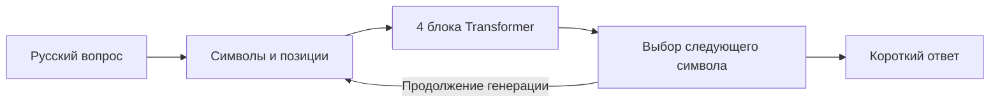

# Tiny-RU: маленький русскоязычный Transformer для DOS и Windows

Tiny-RU — экспериментальная символьная нейросеть, которая отвечает на короткие
вопросы по-русски и работает полностью офлайн. Проект основан на
[Tiny-2.1](https://github.com/WollyMonjac/Tiny-2.1) и сохраняет его компактную
архитектуру: **366 528 параметров**, четыре слоя Transformer и контекст 128 токенов.
Файл весов занимает **381 808 байт — примерно 373 КиБ**.

В русскую версию добавлены словарь кириллицы, набор из 1000 фактических записей
о России, обучение и проверки, ввод CP866 для DOS и Unicode-консоль для Windows.
Ответ генерируется нейросетью посимвольно из весов `TINY.BIN`.

**Текущий выпуск: 2.1r3.** Это учебный проект с ограниченным набором знаний.
Модель может выдавать неверные факты и бессмысленные ответы при перефразировке
вопроса. Сильные результаты на знакомых вопросах оценивают воспроизведение
обученных фактов; обобщение измеряется отдельно.

## Быстрый запуск

### Windows 10/11 x64

Готовые EXE и веса включены в репозиторий. Из CMD в его корне:

```cmd
windows\TINYWIN.EXE
```

Можно открыть `windows/START.CMD` двойным щелчком. При переносе программы
держите `TINYWIN.EXE` и `TINY.BIN` в одной папке. Запускать её можно из любой
рабочей папки. DOSBox, Python и компилятор при запуске не нужны.

Русский ввод и вывод используют Unicode Windows, поэтому менять кодовую
страницу командой `chcp` не требуется. Для выхода введите `QUIT` или `EXIT`.
Описание перенаправления файлов и флагов кодировки — в [инструкции Windows](windows/README.txt).

### DOS и DOSBox-X

В папке `dos/` находятся готовые `TINY.EXE` и `TINY.BIN`. В DOSBox-X:

```dos
MOUNT C "C:\Tiny-RU\dos"
C:
KEYB RU 866
TINY /P 0
```

Замените путь в `MOUNT` своим. В этой конфигурации `Alt` + правый `Shift`
включает русскую раскладку, `Alt` + левый `Shift` — латинскую. Выход — `QUIT`.

Поставляемая DOS-сборка имеет текстовый интерфейс и собрана Open Watcom для
16-битного DOS с инструкциями 386/387. Нужны x86 с сопроцессором
(практически 486DX/Pentium), CP866 и около **540 КиБ свободной обычной памяти**.
Проверки выполнены в DOSBox-X; реальное оборудование не испытывалось.
На 64-битной Windows DOS-сборка запускается через эмулятор, а `TINYWIN.EXE` — напрямую.

### Примеры ответов

```text
> кто президент россии?
  владимир путин.

> куда впадает река волга?
  каспийское море

> в каком году основан город санкт-петербург?
  1703
```

Вопрос ограничен 72 символами поддерживаемого словаря. Ответы короткие,
часто одно слово или число. Текущие сведения в наборе относятся к срезу
источников на **24 ноября 2026 года** и не обновляются автоматически.

## Устройство модели

| Параметр | Значение |
|---|---|
| Архитектура | Decoder-only Transformer |
| Слои / размерность / головы | 4 / 96 / 4 |
| Размер FFN | 256 |
| Параметры | 366 528 |
| Словарь | 97 токенов, включая PAD и EOS |
| Контекст | 128 токенов; обычный токен соответствует символу |
| Матрицы при запуске | int8 с масштабом float32 на строку |
| Формат весов | TNY2, 381 808 байт |
| DOS EXE / Windows EXE | 41 818 / 189 440 байт в поставляемых сборках |
| Обычный режим генерации | Greedy; числовой аргумент 1–9 включает семплирование |



Словарь и таблицы CP866 задаёт [training/vocab.json](training/vocab.json).
Общее вычислительное ядро находится в [dos/TINY.C](dos/TINY.C), адаптер
Windows — в [windows/console.c](windows/console.c). Обе программы используют
побайтно одинаковые веса. В C-runtime также квантуется KV-cache.

## Данные

Текущий набор России: [1000 вопросов и ответов для чтения](data/russia-final/facts.txt)
и [JSONL с источниками](data/russia-final/facts.jsonl).
Запись соответствует связи «объект — свойство»: разные формулировки одного
вопроса и арифметические упражнения не увеличивают это число.

Темы: государство, праздники и символы, космос, регионы и города, реки,
биографии, литература, музеи и памятники. Часть исторических сведений относится
также к Российской империи и СССР. Структурированные данные получены из
Wikidata по CC0, ручное ядро сверялось с указанными официальными источниками.
Полный независимый аудит всех импортированных связей не проводился.

В репозитории сохранены и промежуточные наборы, необходимые для воспроизведения
обучения. **Текущий источник фактов и эталонов — `data/russia-final/`.**
В исходных снимках встречаются неоднозначные значения, исправленные на последнем этапе.
Назначение каталогов описано в [data/README.md](data/README.md), происхождение
и условия использования — в [DATA_LICENSES.md](DATA_LICENSES.md).

## Измеренные результаты

| Проверка | Результат | Что измеряет |
|---|---:|---|
| Знакомая формулировка каждого из 1000 фактов, int8 Python и нативный C | 1000/1000 | Воспроизведение обученных фактов |
| Все 1000 удержанных формулировок, int8 Python | 863/1000 | Другие вопросы об известных фактах |
| Контроль Windows: знакомые / удержанные формулировки | 1000/1000 и 180/200 | Настоящий Windows EXE |
| Контроль DOSBox-X | 13/14 | Небольшой прогон настоящего DOS EXE |
| Ранее зафиксированные регрессионные вопросы, int8 Python | 8/8 | Сохранение конкретных исправлений |

Это точное совпадение с одним из коротких эталонов после нормализации регистра
и конечной пунктуации. Удержанные вопросы не входят в обучение, но их факты
и другие формулировки известны модели. Эти цифры **не оценивают новые знания**
и не являются внешним универсальным бенчмарком.

Пример оставшейся ошибки из DOSBox: «кто занимает пост президента рф?» дало
«михаяль?», хотя обычное «кто президент россии?» отвечает правильно.
После расширения знаний ухудшилось обобщение на прежних темах: старые
перефразировки — 7/40 против 16/40 у r2, арифметика на новых формулировках —
11/30 против 19/30. Знакомые старые вопросы сохранились: 40/40.

Подробности: [карточка модели](MODEL_CARD.md), [отчёт об обучении и DOS](reports/REPORT.md)
и [проверки Windows](reports/windows/REPORT.md). Сырые результаты и транскрипты
сохранены рядом с отчётами.

## Сборка, проверки и обучение

Для разработки нужны Python, PyTorch CPU и NumPy; для запуска готовых EXE они
не требуются. Исходное обучение проверено с Python 3.8.5, PyTorch 2.4.1+cpu и
NumPy 1.24.4. Зависимости зафиксированы в `requirements.txt`.

В Linux/WSL после установки зависимостей:

```sh
sh scripts/build_native.sh
python3 -m unittest discover -s tests -v
python3 scripts/utf8_console.py build/tiny-native
```

Windows из Linux/WSL с MinGW-w64:

```sh
sh scripts/build_windows.sh
```

Или с Zig 0.14.1:

```sh
export TINY_ZIG=/path/to/zig
sh scripts/build_windows.sh
```

DOS с установленным Open Watcom:

```sh
export WATCOM=/path/to/watcom
sh scripts/build_watcom.sh
```

Путь сборки через Turbo C 2.0 сохранён в `dos/BUILD.BAT`, но не проверен.
Пошаговая подготовка окружения и тесты платформ — [docs/BUILD.md](docs/BUILD.md).
Команды всех этапов обучения, исходные чекпоинты и экспорт —
[docs/TRAINING.md](docs/TRAINING.md).

## Состав репозитория

```text
dos/          общее C-ядро, DOS EXE, веса и лицензия его runtime
windows/      Unicode-адаптер, Windows EXE, те же веса и лицензии runtime
training/     Transformer, токенизатор, генераторы данных, обучение, release.pt
data/         текущие данные, снимки источников и наборы предыдущих этапов
tests/        тесты модели, разбиения данных, C-runtime и консольного ввода
scripts/      сборка, оценка, тестирование и упаковка
reports/      измерения, настройки обучения, графики и транскрипты
experiments/  два исходных чекпоинта для воспроизведения этапов
docs/         сборка, обучение, публикация и материалы для статьи
```

Для подготовки публикации см. [docs/PUBLISHING.md](docs/PUBLISHING.md).
Проверенные числа, план статьи и ссылки на иллюстрации собраны в
[docs/ARTICLE_NOTES.md](docs/ARTICLE_NOTES.md).

## Происхождение и лицензии

Это производная работа от **Tiny-2.1**, исходный автор — **WollyMonjac**.
Использован коммит `49348445661ffc9106f243afb4eafe499a51e286`.
Исходное уведомление об авторских правах сохранено в [LICENSE](LICENSE).
Английские веса и сторонние английские корпуса исходного проекта не использовались
для обучения поставляемых русских весов.

Код и оригинальные формулировки распространяются по MIT, структурированные
данные Wikidata — по CC0. У скомпонованных runtime есть собственные уведомления:
Open Watcom — в `dos/WATCOM.TXT`, Windows — в `windows/THIRD_PARTY.txt`
и перечисленных там файлах лицензий. Подробности — [UPSTREAM.md](UPSTREAM.md)
и [DATA_LICENSES.md](DATA_LICENSES.md).
